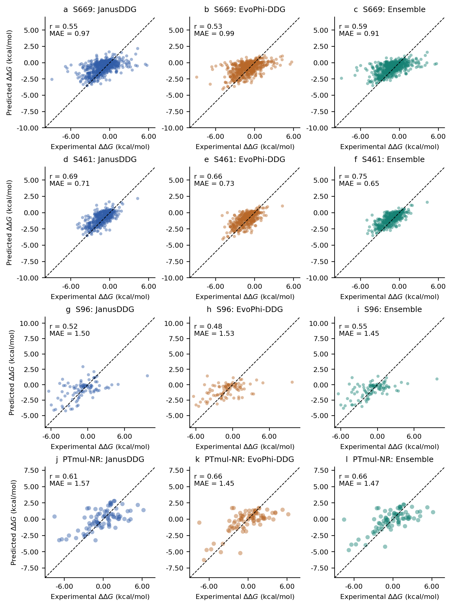

# EvoPhi-DDG

EvoPhi-DDG adapts the published MSAesm_ddG predictor into an antisymmetric potential-difference model for single substitutions and extends it to multiple substitutions. We combine its predictions with JanusDDG by taking their equal-weight mean, without additional training or calibration.

This repository contains the benchmark predictions, experimental labels, pathway data and analysis code used for the paper. Figures, LaTeX tables and numerical results can be regenerated on a CPU without downloading model weights or running an alignment search.

## Results

Pearson correlations against the experimental labels distributed with JanusDDG:

| Benchmark | Variants | JanusDDG | EvoPhi-DDG | Ensemble |
| --- | ---: | ---: | ---: | ---: |
| S669 | 669 | 0.55 | 0.53 | **0.59** |
| S461 | 461 | 0.69 | 0.66 | **0.75** |
| S96 | 96 | 0.52 | 0.48 | **0.55** |
| PTmul-NR | 82 | 0.61 | **0.66** | **0.66** |

See [all regression metrics](docs/results.md), [unrounded numerical results](results/) and [bootstrap comparisons](results/bootstrap.csv). Bold marks the highest value at the displayed precision. On PTmul-NR, EvoPhi-DDG has a slightly higher unrounded Pearson correlation than the ensemble. S461 overlaps S669 and is a curation sensitivity analysis; S96 also contains shared variants, documented in the supplied overlap audit.



## Predict your own variants

The [ready-to-use inference pipeline](inference/README.md) starts from your WT sequence and mutations, finds and filters the MSA, runs both models and returns **EvoPhi-DDG, JanusDDG and ensemble DDG** in one CSV. Ready-to-use weights are supplied in the [checkpoint release](https://github.com/bardu98/EvoPhi-DDG/releases/tag/checkpoints-v1) and downloaded automatically on first use.

Install once from the repository directory:

```bash
conda env create -f inference/environment.yml
conda activate evophi-ddg
```

Then predict a variant:

```bash
python inference/run.py --fasta my_protein.fasta --mutations K13A --output predictions.csv
```

Positions refer to the exact sequence in your FASTA, starting at 1. Join substitutions within one multiple mutant with underscores, such as `K13A_L22V`; separate different variants with spaces. For a working example, use `inference/examples/protein.fasta` with `K13A`, or run `--input inference/examples/variants.csv`.

The output columns are `DDG_EvoPhi_DDG`, `DDG_JanusDDG` and `DDG_Ensemble`, in kcal/mol, with positive values indicating stabilization. The first use downloads the model weights and ESM2 backbone; subsequent runs reuse them. A GPU is recommended and CPU inference is supported. New sequences are sent to the public ColabFold service for alignment search; existing alignments can be supplied for local or offline use. See the [inference guide](inference/README.md) for batch inputs, caching, supported sequence lengths and access to weights while the repository is private.

## Reproduce figures and tables

Use Python 3.11. From the repository directory:

```bash
python -m venv .venv
source .venv/bin/activate
pip install -r requirements.txt
python scripts/reproduce.py
python scripts/verify.py
```

The first script recomputes regression, classification, bootstrap comparisons, same-site and multisite pathway statistics, figures and LaTeX tables. The second checks the frozen input hashes, label mapping and agreement with the reference numerical results. The complete run took about 20 seconds in the original environment; runtime depends on the CPU.

To redraw figures from the existing numerical outputs:

```bash
python scripts/reproduce.py --figures-only
```

Every empirical comparison uses the same frozen JanusDDG labels. No model is trained and no test-set parameter is fitted by these commands. The [reproduction guide](docs/reproducibility.md) maps each figure and table to its source data and script. CSV and JSON files preserve full precision; figures and tables use two decimals, with scientific notation for small physical defects and near-unit correlations.

## Model and inference

For a fixed mutation site and alignment context, EvoPhi-DDG has the form

```text
EvoPhi(A, B) = U(A) - U(B)
U(A) = (vᵀ W / 2) phi(A)
```

Here `W` and `v` are the published MSAesm_ddG head weights. We set the hidden bias to zero and antisymmetrize the prediction; the output bias cancels. This gives exact antisymmetry and same-site transitivity in exact arithmetic. It does not imply exact transitivity across different sites.

Multiple substitutions use independent single-site changes from each complete endpoint, followed by a whole-variant antisymmetric projection. They are not predicted by summing only the substitutions from the WT background. The [method description](docs/methods.md) distinguishes the primary construction from sequential and all-order controls.

The optional [inference script](docs/inference.md) accepts prefiltered MSAs and the original checkpoint. Alignment preparation and inference require additional tools and model downloads. The reproducibility commands above operate on the frozen predictions and pathways supplied here; they do not repeat the original database searches.

## Repository contents

| Directory | Contents |
| --- | --- |
| `data/` | Experimental labels, exact benchmark sequences and mutations, model predictions and pathway data |
| `results/` | Unrounded results in CSV format |
| `analysis/` | Statistical analyses and figure/table generation |
| `figures/` | PDF and PNG figures, plus static model diagrams |
| `generated/` | LaTeX tables, statistical JSON files and provenance records |
| `reference/` | Frozen numerical outputs checked by the verification script |
| `evophi/` | Potential readout and multiple-substitution projection |
| `inference/` | Complete sequence-to-prediction workflow, setup, examples and checkpoint downloads |
| `scripts/` | Reproduction, verification and inference entry points |
| `docs/` | Methods, parameters, data definitions and source attribution |

This release covers the four manuscript benchmarks and their physical-consistency tests. Exploratory training experiments and the ongoing megadataset analysis are outside its scope.

## References and source models

- Cuturello et al. *Enhancing predictions of protein stability changes induced by single mutations using MSA-based language models*. Bioinformatics (2024). [Paper](https://doi.org/10.1093/bioinformatics/btae447) · [MSAesm_ddG source](https://github.com/RitAreaSciencePark/PLM4Muts) · [Published weights](https://zenodo.org/records/14026821)
- Barducci et al. *JanusDDG: a physics-informed neural network for sequence-based protein stability via two-fronts attention*. Communications Biology (2026). [Paper](https://doi.org/10.1038/s42003-026-09632-9) · [JanusDDG source](https://github.com/compbiomed-unito/JanusDDG)

Further references are in [references.bib](references.bib). The EvoPhi-DDG manuscript is in preparation; no publication identifier is assigned here.

## License

Repository code is distributed under [AGPL-3.0-or-later](LICENSE). Original model weights, upstream code and benchmark data retain their respective licenses and attribution. Ready-to-use model checkpoints are distributed through repository releases. See [source and license notes](docs/sources.md) and the [inference guide](inference/README.md).
