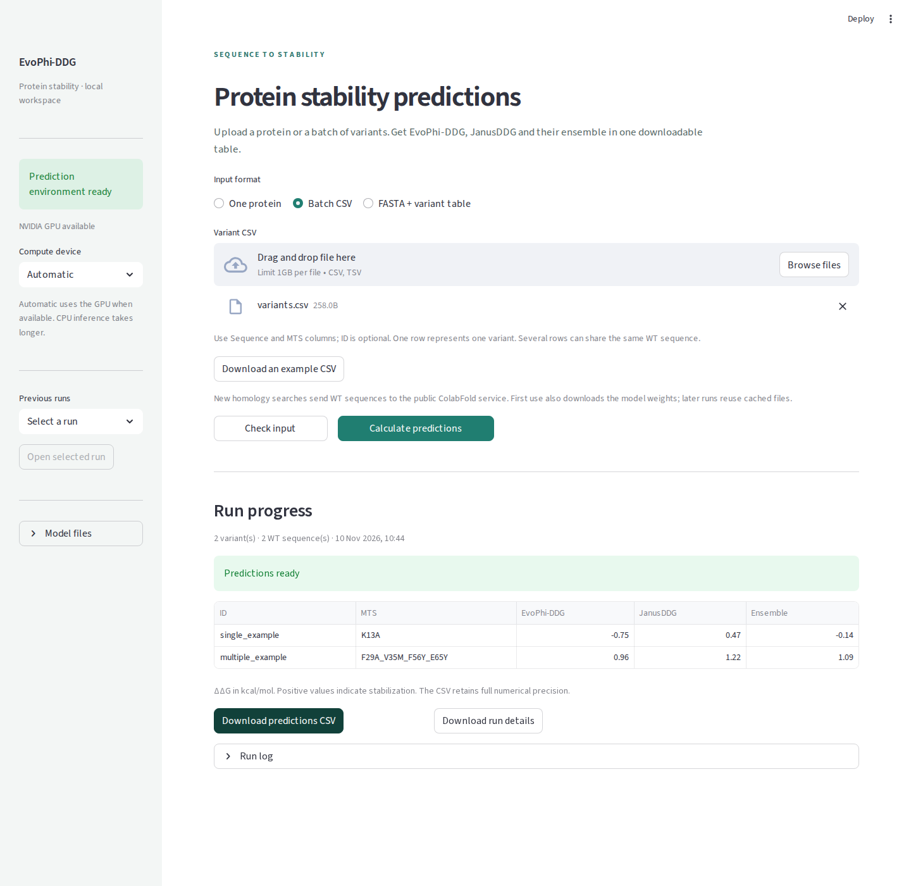

# Use EvoPhi-DDG in your browser

The local app accepts sequences, FASTA files and batches of variants. It runs the same frozen prediction pipeline as the command-line tool and provides a downloadable CSV containing EvoPhi-DDG, JanusDDG and ensemble ΔΔG values.



## Open the app

Download the repository ZIP from GitHub and extract it into a writable folder.

- **Linux x86_64:** run `Start EvoPhi-DDG.sh` from the repository folder. Your file manager may require enabling “Allow executing file as program” first. You can also open a terminal in that folder and run `bash "Start EvoPhi-DDG.sh"`.
- **Windows:** install [WSL2 with Ubuntu](https://learn.microsoft.com/windows/wsl/install) once, then double-click `Start EvoPhi-DDG.bat`. The app runs in WSL and opens in your Windows browser. This launcher requires an existing WSL installation; it does not install or configure WSL itself.

On first launch, the guided setup finds your Conda installation or offers to install Miniforge inside the project. It creates a dedicated environment under `.cache/app-env`, including Python, HHfilter and the model dependencies. Later launches reuse that environment. No administrator rights are needed for the Linux app environment.

The first setup and model downloads require several GB of space and an internet connection. A compatible NVIDIA GPU is recommended for prediction; CPU inference is supported and slower. The guided launcher currently targets Linux x86_64 and Windows through WSL2. macOS is not validated in this release.

The browser address is normally **http://localhost:8501**. If the port is occupied, the launcher chooses another free local port and prints the address. The app listens only on your own computer. Keep the launcher window open while using the interface.

## Choose your input

### One protein

Paste the complete WT amino-acid sequence or upload one FASTA file. Enter one variant per line:

```text
K13A
L22V
K13A_L22V
```

These are three separate variants: two singles and one double mutant. Positions start at **1 in the sequence you supplied**, rather than PDB residue numbering. Replace the examples with mutations that match your own protein. “Load a real example” fills a valid sequence and mutation for you.

### Batch CSV

Upload a table with `Sequence` and `MTS` columns; `ID` is optional. Each row is one variant. Several rows can share a WT sequence. Download the example CSV in the interface to see the format.

### FASTA + variant table

Upload a FASTA containing multiple proteins and a CSV with `ID` and `MTS` columns. Each `ID` must match the first word after `>` in its FASTA header. The interface matches the sequences to the table and preserves the table's row order.

Click **Check input** to preview the validated variants. Errors identify the row and mismatched residue. Validation does not submit an alignment search.

## Calculate and download

Click **Calculate predictions**. The interface shows preparation of model weights, alignment search and filtering, EvoPhi-DDG, and JanusDDG. Completed variant counts are shown where available; no artificial time estimate is displayed for the remote MSA queue.

The results table contains all three ΔΔG estimates in **kcal/mol**, with **positive values indicating stabilization**. Values are displayed with two decimals. **Download predictions CSV** saves the complete original numerical precision together with the validated inputs. “Download run details” records the checkpoint hashes and alignment provenance.

You may refresh or close the browser tab without starting a duplicate calculation. Keep the computer running. Reopen the app and select the run under **Previous runs** to inspect its progress or download the results. Only one GUI inference job uses the shared model/cache resources at a time; additional jobs wait in the local queue.

**Stop this run** stops that calculation and preserves cached alignment work. **Retry using cached work** reuses accepted MSA tickets, completed alignments, weights and ESM2 embeddings. A computer shutdown interrupts the calculation; reopening the app lets you retry it rather than reporting an interrupted job as successful.

## Models and existing alignments

Both ready-to-use checkpoints are downloaded and SHA256-verified automatically. The ESM2 backbone is also downloaded on first use. While the repository is private, GitHub authentication may be required. As an alternative, open **Model files** in the sidebar, download the two files from the linked checkpoint release in your browser, and upload them there. The app checks their hashes before saving them.

If a model download reports GitHub CLI exit status **4**, the command-line client is not signed in on that computer. Your browser's GitHub login is separate. You can resolve this entirely in the interface: download `evophi-ddg.pt` and `janusddg.pt` from the release, add each under **Model files**, click **Verify and save checkpoint**, then **Retry using cached work**. Alternatively, run `gh auth login` in the prediction environment to enable authenticated automatic downloads.

New homology searches send WT sequences to the public ColabFold service. In single-protein mode, **Use an existing alignment** lets you upload an alignment instead. By default it receives the same HHfilter treatment as online results; mark it already filtered only when it has been prepared with the intended protocol. Its first row must match the complete WT sequence.

The same sequence-length limits, alignment protocol, fixed homolog contexts, zero-bias EvoPhi-DDG readout and multiple-substitution construction documented in [inference/README.md](../inference/README.md) apply. Batch inputs with precomputed local alignments remain available through the command-line workflow.

## Existing environments and remote computers

If you already have the inference environment, install the interface and launch it directly:

```bash
pip install -r gui/requirements.txt
python gui/launch.py
```

Streamlit is pinned to a version compatible with the existing NumPy/pandas requirements. The launcher binds to `127.0.0.1` and disables usage telemetry. On a remote Linux workstation, use SSH port forwarding to reach its localhost address; this version is a local application, not a public multi-user server.

## Verification

Input mapping, validation, job interruption and cancellation are tested with:

```bash
python -m unittest discover -s gui/tests
```

Browser-level checks exercise real model inference, a refresh during the calculation, CSV download and agreement with the frozen benchmark predictions. The original inference and paper reproduction checks remain separate. The interface does not change model parameters, ensembles or benchmark labels.
